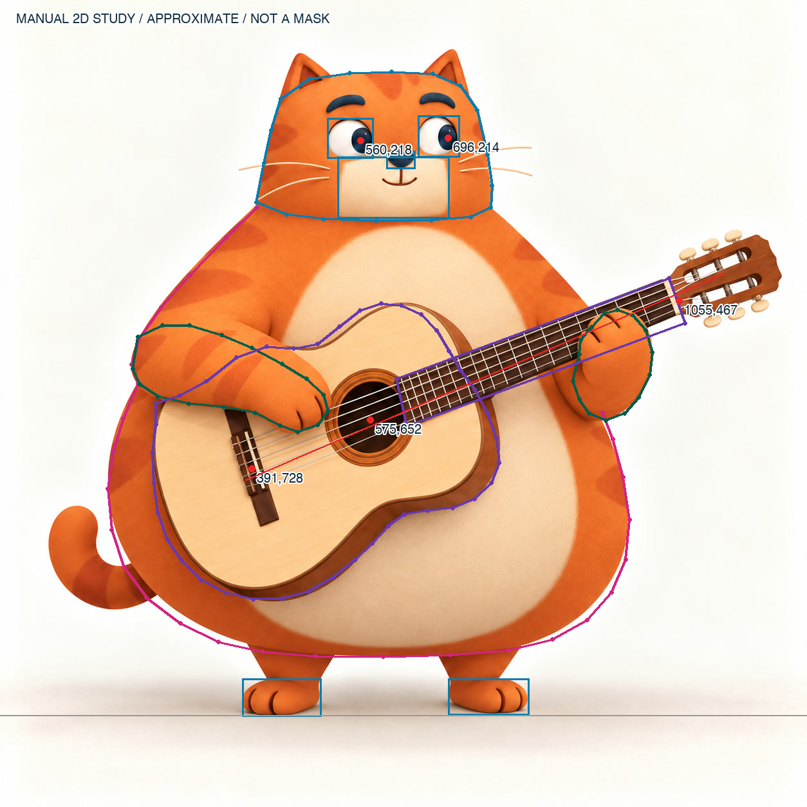

# Miao 原图建模标尺 / 2026-10-28

这是对现有图像的**人工近似二维量测**，供相机与连续曲面建模使用。没有新建模型，没有通过灰模/着色/动作验收。坐标不是自动分割，也不是从一张图推得的真实三维；目测点通常有约 ±5–12px 的偏差。细毛、胡须和柔影不纳入主轮廓。不要把本文件的比例诊断当作可爱或精致评分。

## 主参考与已有辅助图

- 唯一主标尺：[`idle.jpg`](../../public/character/instrument-scenes-v1/guitar/idle.jpg)，1254×1254，SHA256 `4418fd737891283f42568306cb427b1f7604a86cae5513b1d6c49b3c31f338d1`。
- [`01-turnaround.png`](../video-motion-pilot-2026-10-23/01-turnaround.png)，2022×778，正/侧/背三视图。实际查看后，宽梨形身体、头身连续、圆方脸、短足、朝右视线、短尾、贴附条纹都与主图相符，是现有最一致的背侧形态辅助。**它是先前图像生成参考，不是同一模型的正交摄影，也不是遮挡部位的真实证据**；侧图的体厚和背部条纹只能作待验证设计约束。
- [`02-guitar.png`](../video-motion-pilot-2026-10-23/02-guitar.png)，1672×941。实际查看后属于同一胖橘猫+大斜琴方向，横画幅且相机/比例略有变化；不能把它与1254主图的像素坐标混用。
- 对照的被否决模型：[`poster.webp`](../../public/labs/blender-guitar/poster.webp)。它的大球头、窄长主体、正面眼神、大脚和横小琴都偏离主图；这里不把它作为尺寸基础。

蓝色=头/眼/鼻/口鼻/脚的二维区域；粉色=**可见**体表边界（未闭合，不虚构琴和爪后面的轮廓）；绿色=可见两爪轮廓；紫色=琴面/指板观察控制曲线，局部被爪遮挡的连接段只用于构图，不能作为穿透mask；红色=瞳孔/琴轴点。

## 直接可用的像素量测

原点左上，x向右，y向下。下列均为近似可见量，不含景深/透视纠正。逐点数据见 [`landmarks.json`](landmarks.json)，重生裁剪/诊断标注用 [`measure_reference.py`](measure_reference.py)，不改生产原图。

| 量 | 像素范围 / 数值 | 建模意义 |
|---|---|---|
| 耳顶到脚底 | y≈77–1113，1036px | 总高基准，不把投影/影子算身高 |
| 不含耳的头部 | x≈398–765，y≈111–343；宽367，高232 | 头是横向圆角梯形/圆方体，宽高≈1.58；不是球或长圆脸 |
| 头底与肩的连接 | y≈319–350，左右轮廓直接向外展 | 没有细脖子，没有额外“球头压身体”的接缝 |
| 身体可见范围 | x≈166–978，y≈322–1020；宽812，高698 | 身宽≈总高0.784；从肩向腹侧连续扩宽，下腹收圆 |
| 头宽/身体最大宽 | 367/812≈0.452 | 球头做得接近身宽会直接换身份 |
| 下腹最宽处 | y≈760–825，x≈167–978 | 重心低，肚子宽；不是胸宽肚子窄的直立人形 |
| 屏幕左眼白 | bbox≈508,183–580,246 | 72×63；眼球有体积，顶缘被上睑包裹 |
| 屏幕右眼白 | bbox≈649,179–714,244 | 65×65；左右眼不是复制同样正视模板 |
| 瞳孔中心 | 左≈560,218；右≈696,214 | 相对各自眼白中心，均明显偏画面右；右眼瞳孔接近右侧边缘 |
| 眉曲线 | 左≈510,169→538,154→562,160；右≈657,156→680,150→704,166 | 厚、拱、外端稍低，不能用细直棒代替 |
| 鼻区域 | bbox≈600,234–645,262 | 蓝黑圆三角，宽45，高28；不做长尖鼻 |
| 奶油口鼻 | bbox≈524,243–698,339 | 宽174，高96，圆角方区，贴着脸体；不是突出一大截的球状嘴套 |
| 两脚 | 左bbox≈376,1054–499,1113；右≈696,1054–822,1111 | 每只可见爪宽约123–126、高57–59；脚只是短小承重末端 |
| 腹底到脚底 | ≈94px，即总高9.1% | 短腿不等于把整猫压扁；避免放大脚来假装稳定 |
| 屏幕左前爪 | bbox≈204–509,505–673 | 从左侧粗圆肩臂平顺弯到琴弦上，连贯无腕圈；手指只有两道克制缝线 |
| 屏幕右前爪 | bbox≈890–1013,481–653 | 左手握指板、手背外凸；不是用指尖从正面机械戳板 |
| 琴体 | bbox≈237–775,471–931 | 大琴体覆盖主体左中下腹，相对身体宽约66% |
| 琴主轴 | (381,746)→(1125,425)，向右上≈23.34° | 先匹配23°斜琴，旧样机约横置的观感错误不能靠弦数补偿 |
| 音孔 | 中心≈575,652；bbox≈517,589–635,716 | 受斜琴与视角影响，不能任意挪到腹中心 |
| 琴桥/琴枕 | 桥中心≈391,728；枕中心≈1055,467 | 主轴上两个锚点，用来定位琴弦面与右爪接触 |
| 琴头可见区域 | x≈1039–1214，y≈365–502 | 琴头几乎到画面右缘，整琴的横向跨度远大于旧样机 |

## 相机匹配：先消掉构图错误

1. 先用**正交相机**做二维构图校准，原图作为相机背景，不把它投在生产角色上。建立单独 `Reference` 集合，最终渲染关闭。是否改长焦透视须看侧面细节，不能只凭一张图声称已恢复原焦距。
2. 可暂定500px/Blender unit、地面y像素1111。投影标尺为 `X=(x-590)/500`、`Z=(1111-y)/500`；若画面1254px，正交高度暂为2.508u。这样耳顶Z≈2.068、头底Z≈1.536、下腹底Z≈0.182、脚底Z≈0。X原点590只是便利坐标，不是断言解剖中线。
3. 使用前视方向先锁整身占幅，再仅以轻微俯仰/水平偏转修可见上表面与琴厚度。**不能转到有利角度掩盖脸或腹部差距**。画面右侧视线来自眼球朝向，不等于把整个头转到另一只猫的三分之二侧脸。
4. 先放脚底、腹底、耳顶、头左右、腹最宽左右六组锚点；再放音孔、琴桥、琴枕、两爪。相机先固定，再改几何。不得一边换镜头一边用旧像素比例评“进步”。
5. 输出至少1024整身、脸/两爪局部和中性灰模。灰模先检查轮廓和接触预备；短毛/条纹不会改变这些几何验收值。

## 连续曲面重建：不是堆球体重演

这里给出的是**待实施的参考驱动建模方法**，不是宣称已存在合格拓扑。

- 用横向椭圆/超椭圆截面逐环构成一个头身连续的主体表面，正面x边界由主图控制，深度和后脑过渡仅以三视图辅助并标待验证。头部采用圆角梯形轮廓：额顶平缓、脸颊近竖向但下部略宽、下颏圆方收边。由头底直接沿连续肩坡扩成下腹，不创建可见细颈。
- 主体在 y像素≈320→800 的区间持续扩宽；最宽处在低腹。用相邻截面曲率约束，避免头底的台阶与腹底硬削平；腹底是圆角回收，不是球体与鞋的直线切口。
- 两侧肩臂是从躯干侧表面自然生出的连续短粗肢体。先在连续主体上预留肩连接边流；极少量骨骼控制肩/肘/爪，前臂和掌用连续表面过渡。不要复用被否决样机的管臂/球腕拼装。
- 眼眶做真实凹包结构与可开合眼睑，眼白球面落入脸体，瞳孔/虹膜偏向右。口鼻色区是毛色边界，鼻/口线是小体积细节，不能把整块口鼻挤出成单独大白球。
- 猫和琴必须是可分别编辑的物体，握琴和触弦局部至少看侧视/剖面；单图中被琴挡住的腹部和右前臂后侧不能假装已经看见。每个最终渲染仍必须是一帧完整猫+相连双爪+琴。
- 若图生3D输出把琴/爪/胸粘合，它可作比例/色彩参考，不能立即绑定整体转动。以本页锚点重建可变形接缝与遮挡结构后，才进入接触审计。

## 当前结论与下一次验收

已有三视图比现Blender样机更忠于身份，但仍是辅助图。完成本次量测并不等于建模成功。下一个合格证据应是**当前候选的原生mesh+同机位灰模**，与主图并排；三位独立角色/材质/接触评审查看后才能继续材质和动画，任一 P0 仍阻止交付。相机原参数、深度、背面、肩肘边流、眼睑变形和真实弹奏接触目前均未验证。
