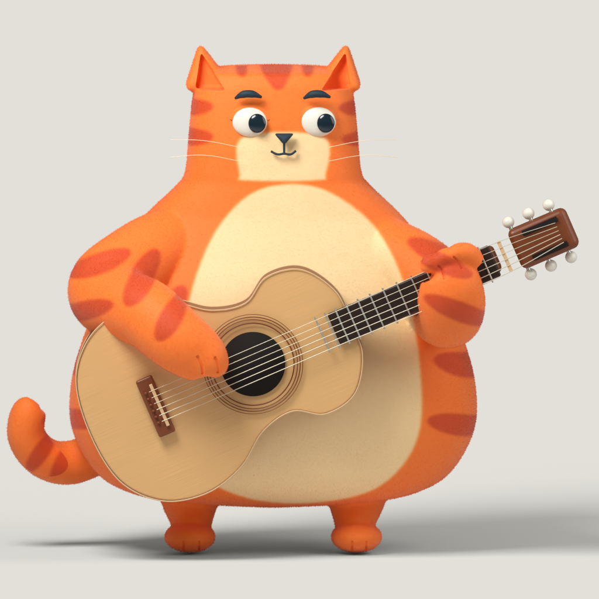

# 原图驱动连续曲面：Blender 静态候选

2026-10-28。**这是制作中的资产，未完成角色／演奏／网页验收。** 旧球猫被用户否决后，本候选从原图标尺重建，不把旧样机的模型当合格基础。只复用项目已有的吉他建模函数与工作流；没有导入外部猫模型。

## 实际做到哪一步

- 原图轮廓、脸、爪、脚、琴轴已有[近似二维量测](../character-reference-study-2026-10-28/README.md)。原图唯一主标尺仍是 [`guitar/idle.jpg`](../../public/character/instrument-scenes-v1/guitar/idle.jpg)；背面仅用已有生成三视图辅助，不称恢复了真实背面。
- `scene.py` 创建单一头身连续的定制截面网格，肩臂／耳／足通过雕刻分辨率的融合形成完整连接表面。没有分离手臂贴片、旧球头或旧管臂。猫与吉他是分别可编辑对象，每张渲染仍是完整场景。
- r3灰模经三方独立实图评审判失败：眼白外凸、缺眼睑、鼻形与无短趾手套。r6修了爪／三角鼻／尾／足趾，仍因整圈眼框被身份评审拦住；r7改为上睑包覆并融回脸面后，三个角色的B阶段P0解除，**只允许进入C静帧制作**。
- 拨弦爪和足趾的浅沟来自固定相机上的作者标线，再用射线找到实际网格表面进行Boolean雕刻。`sculpt-guides.json`记录像素和落到表面的三维点；这是可重复的建模操作，不是往成片上画黑线。
- `miao-reference-gray.blend` 是r7可编辑工程，已内嵌原图作者参考。它有完整模型、相机、灯光、材质边界及隐藏的雕刻cutter；预设正面相机，参考图不参与最终渲染。
- `shade.py` 是C阶段材质制作脚本，使用手工设计的平面毛色色图与真实短绒曲线，不把原图照片投到替身上。C图生成后还须三方独立对照；脚本存在不等于材质通过。

## 当前彩色制作记录

C2三方评审未通过：粉桃色、单色臂套、木材不可读和灰背景。C4修暖橘与条纹、琴局部木纹、ShadowCatcher奶油空间后，被三方拦在前臂亮细缝。C5去掉按cream色值阈值分类，改用独立、无cream但保留同款条纹的前臂色场；已实际完成两张1024渲染，三方复评已确认前臂亮缝P0消失，静态P0清除，仅允许进入窄D0验证；全部精致度P1保留，不代表最终角色完成。`miao-plush-static-study.blend` 是C5工程，仍是静态研究。



C阶段独立记录：[身份](../../docs/research/character-sculpt-v2-color-identity-review-2026-10-28.md)、[工艺](../../docs/research/character-sculpt-v2-color-craft-review-2026-10-28.md)、[接触](../../docs/research/character-sculpt-v2-color-contact-review-2026-10-28.md)。失败历史没有删除。

## 复现

本机实测 Blender **5.2.3 LTS / e13b728c6880**，Apple M1 Pro Metal。需要仓库原图及原有 `design/blender-guitar-v1/scene.py` 中的自有吉他函数；不需要第三方模型权重。

```sh
/Applications/Blender.app/Contents/MacOS/Blender -b --python design/character-sculpt-v2/scene.py -- --output artifacts/character-sculpt-v2-repro --size 1024 --samples 48
/Applications/Blender.app/Contents/MacOS/Blender -b design/character-sculpt-v2/miao-reference-gray.blend --python design/character-sculpt-v2/audit.py -- artifacts/character-sculpt-v2-repro/geometry-audit.json
```

重新设计毛色图需要Pillow（仓库已有motion-venv可用），然后在灰模工程上执行材质脚本：

```sh
python3 design/character-sculpt-v2/create-coat-map.py
/Applications/Blender.app/Contents/MacOS/Blender -b design/character-sculpt-v2/miao-reference-gray.blend --python design/character-sculpt-v2/shade.py
```

C脚本默认输出到 `artifacts/character-sculpt-v2-color-5/`，可传 `-- --out artifacts/my-study --size 1024 --samples 64`，写出工程与两张静帧。两张pigment PNG均由`create-coat-map.py`制作，不含原图像素。不能拿旧目录残留图代替本次成功；以终端退出、图片时间／hash与receipt为准。

## 已验与边界

r6实际求值网格为610,764顶点、610,762面，只有一个猫体连通分量。局部30个爪弦射线探针有7个找到爪区间，所取样的弦点均未落在爪体内；这些间隙支持“弦前准备姿态”，**不是已经贴弦或所有碰撞通过**。23个没打到爪的点不能算接触成功。r7未改变爪，新增的眼睑不影响这项局部诊断。证据见 [`geometry-audit-r6.json`](evidence/geometry-audit-r6.json)。

没有可变形肩肘腕边流／骨架／蒙皮证据。voxel融合与一个连通分量都不能证明能自然弯折。闭眼极限、实际触弦与离弦、头眼／呼吸、网页连按和导出都还未在本资产上验证。原型的98项测试不适用于本资产的美术或动作。

独立评审保留历史：

- [身份与轮廓](../../docs/research/character-sculpt-v2-gray-identity-review-2026-10-28.md)
- [工艺与脸部结构](../../docs/research/character-sculpt-v2-gray-craft-review-2026-10-28.md)
- [抱琴接触与可动画性](../../docs/research/character-sculpt-v2-gray-contact-review-2026-10-28.md)

P1仍包括眼角接缝／鼻圆润度、掌体与指沟、琴位置／包边、耳窝与尾块感。任何C阶段新增P0会重新阻止动作扩张。正式站仍保留原猫，本目录不代表已发布替换。

## 在Blender中操作

用Blender5.2.3打开`miao-plush-static-study.blend`；数字键0切到固定相机，F12渲染当前机位，Esc返回编辑。该工程没有动作／播放控制，时间轴播放不应被解释成角色已动画化。模型主对象`Miao / continuous pear and rounded-square face`为猫体，`Guitar / ...`为独立乐器，`Miao / native short plush`为真曲线短毛；`Authoring / ...`是隐藏切削参考，不能误删后还声称相同造型。

毛色先改`create-coat-map.py`，再运行它与`shade.py`重建C工程；勿直接改被打包图片而不保存来源。几何以`scene.py`的实测截面与连接面改形，重生灰模后先重新评审，再应用材质。保存你修改的副本；本目录原工程保留作hash对照。

Blender5合成使用独立`CompositorNodeTree`与Group Output；本机已实际验证节点图及成片，参见[官方迁移说明](https://developer.blender.org/docs/release_notes/5.0/migration/compositor_migration/)。ShadowCatcher仅接收真实阴影，再合成奶油背景，避免200m地板铺满画面变灰。
