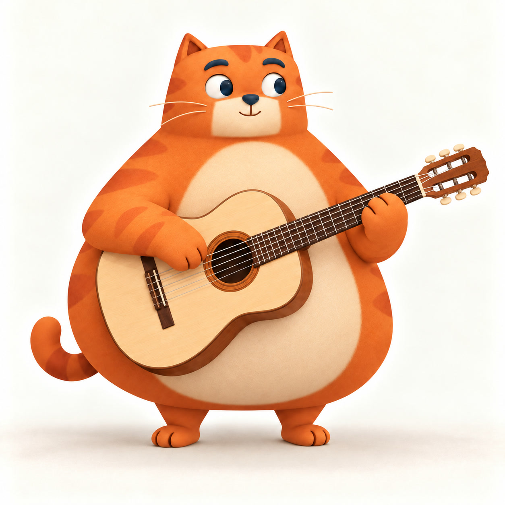
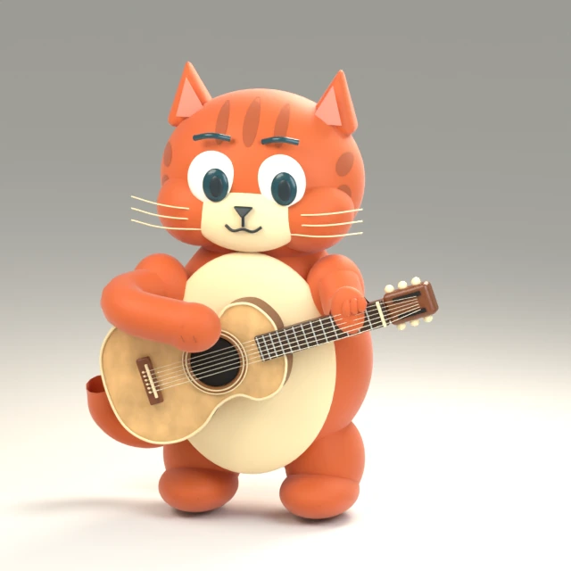

# Miao 角色精修计划 · 2026-10-28

**当前结论：Blender 首版美术不合格。** 用户已明确否决造型粗糙、与原图差距巨大。它只证明完整场景渲染、按键和媒体导出可以跑通；98项功能测试、恒骨长和编码成功均不能抵消视觉失败。本轮先形成可执行制作方案和对照评审，不把“换工具”当作质量提升。

## 1. 固定目标，停止修错方向

主参考是 [`guitar/idle.jpg`](../public/character/instrument-scenes-v1/guitar/idle.jpg)，SHA-256 `4418fd737891283f42568306cb427b1f7604a86cae5513b1d6c49b3c31f338d1`。当前被否决的样机是 [`poster.webp`](../public/labs/blender-guitar/poster.webp)，SHA-256 `62037cedfd1a1feb243ecd874e6bde7064a16b4d0c8be274ff4f66f0f0c8cc3d`。先按完整画面和脸/爪/琴局部对照，不能只看新图自己是否像猫。

| 原图基准 | 被否决的技术样机 |
| --- | --- |
|  |  |

必须保留：宽阔矮胖的梨形主体、头身融合的圆方脸、小而稳的耳朵、短腿小猫爪、朝画面右侧看的神态、厚弧眉、细短绒毛、贴着毛皮的条纹，以及相对猫更大、更斜的吉他和自然抱持。

当前大球头、竖窄身体、分节大脚、正面大白眼、光滑胶泥表面和小横琴都属于方向性退步。**不继续在这个球体/管臂模型上加毛、加动作或加渲染采样。** 保留其可复用的输入、音频、录制、接触审计和整帧输出能力，角色资产重新选路。具体对照见[独立差距评审](research/blender-original-gap-review-2026-10-28.md)。

## 2. 复用路线：先看候选是否能保住 Miao

| 路线 | 实际用途 | 采用前必须证明 |
| --- | --- | --- |
| 原图驱动的图生3D，再整理网格/UV/材质 | 作为保留轮廓和色块的初始资产候选；先按原图保留程度、网格可修性和许可筛选；Mac可运行仅作成本条件，不能高于质量要求 | 能导出可编辑模型；猫/琴/爪没有粘成一体；脸、背面与关节可修；许可、硬件、权重体积与运行条件清楚。生成一张有贴图的网格不等于已绑定、已长出绒毛或动画可用；背面及遮挡区均是待验证重建，不承诺自动正确。 |
| 成熟猫角色或专业绑定资产 | 借用连续拓扑、眼睑、口鼻、爪形变、groom和rig方法，减少重复造基础设施 | 实际预览接近目标；原生工程可改形而不毁蒙皮；模型许可独立明确。细长猫、四足写实猫和低模飞行员猫不能因为“可import”就替换胖橘猫。 |
| 按参考重建连续雕刻/重拓扑角色 | 前两路形状不匹配时的可靠后备，复用成熟rig/材质方法 | 在正确相机下先还原轮廓、面部和姿态，再做细节；使用连续可变形表面，避免程序几何拼装感。不能把脚本成功创建mesh当美术验收。 |

候选及真实源码、许可证、硬件边界见[图生3D方案](research/image-to-3d-options-2026-10-28.md)与[专业制作方法](research/character-quality-method-2026-10-28.md)。原网页[项目复用调查](research/blender-web-input-references.md)只证明交互/导出等可借鉴，不证明它们有接近原图的角色资产。

执行顺序：先用有明确来源的少量候选做静帧能力验证，最多两次同类失败即停止该路线；不批量下载权重、不调用收费接口、不先购买模型。若最合适资产需要费用，先准备具体商品、许可、原图差距和替代方案再提出有边界的选择，不让用户批准模糊的“继续”。

## 3. 分阶段推进，前一关不过不扩下一关

**B灰模和C着色静帧各自就执行三名独立subagent的阶段评审，不能等到G才第一次审美术。** 静帧阶段第三人检查抱琴、接触预备、关节形变和后续可动画性；尚不存在的动画/网页项标为“尚未验证／本阶段不适用”，不提前算通过。G是最后复核。

| 阶段 | 产物 | 通过条件 / 停止条件 |
| --- | --- | --- |
| A 参考与构图 | 原图基准、完整轮廓、脸/爪/琴观察记录；补齐既有三视图与遮挡说明 | 锁定同一角色和相机；尺寸/角度比较有实际依据，不把不可见背面细节写成事实。 |
| B 资产最小试验 | 一个导入或重建的中性灰模、原生工程、来源/版本/许可、正面与侧面截图 | 缩到小尺寸仍保持胖橘猫轮廓；圆方脸、头身/腿足比例、琴尺度角度与原图接近。P0不符即停止材质/动画扩张。 |
| C 着色静帧 | 至少1024px同机位美术图、灰模图、脸/爪/木材局部及原图并排对照 | 有细短绒感和贴附条纹；眼眶/眼睑/眉/口鼻有层次，眼球与眼睑具备可绑定的真实结构而非只画在贴图上；手爪与躯干连贯；木材、尼龙弦、眼睛和毛皮材质可区分；奶油背景与柔光不漂灰。不用高光/毛发遮盖错误形状。 |
| D0 窄范围网页组合试验 | C静帧通过后，只用第一条拨弦和一轮眨眼/视线小样，比较完整离线帧与完整统一模型的呈现 | 手动作在不同眨眼阶段切入，头眼/呼吸时钟不因按键重置；不能拆体图层；无停手后补演；整帧导出一致。记录素材体积、峰值内存与输入延迟，未知项如实记。组合/材质不成立就先换运行方式，不扩E整套短片。 |
| D 绑定与单次演奏 | 预备、接触、拨过、离弦、回位完整序列；关节极端姿态检查 | 肩肘腕连接自然、无可见伸长/塌陷/穿琴；一个输入一次主要触弦；回程绕开弦面。静帧美术需保持，不因绑定变形降质。 |
| E 头眼与身体配合 | 静待、单按、慢弹、连续弹四种短片 | 微动作服务演奏而不抢注意力，脸和脚稳定，停手后自然平复，不能每音重播一整套点头。细则见下一节。 |
| F 网页路线小样 | 同一资产的浏览器呈现与离线渲染对照、实际录制导出 | 保住美术质量后才定最终运行方式；完整角色和乐器始终在同一画面，不拼独立手臂图。声音即时、动作无积压，导出成片复验。 |
| G 独立评审与发布 | 三份独立subagent评审、主agent复核、缺口/修复记录、浏览器与成片证据 | 轮廓/神态、材质/完成度、动作/体验三组P0全部解决，才称本轮角色优化完成。失败结果如实记录，不用总分或测试数平均掉视觉阻塞。 |

### 线上呈现不提前锁死

Blender首先是角色资产与动作制作工具。最终可比较：完整离线渲染帧保留毛绒/灯光质感，或完整统一蒙皮角色的实时渲染让头眼/身体动作独立连续。Blender原生hair/GeometryNodes/groom及着色器不会因导出GLB自动等效出现在网页；须验证毛发卡片/网格或烘焙替代与离线成片的质量差距。后者必须先验证fur、阴影、材质和设备性能，不因“能加载GLB”就采用；前者必须验证动作组合与再触发，不靠倒放/crossfade掩盖跳变。两条路线都不允许退回身体底图加独立手臂的模式。

## 4. 追加需求：头、视线和身体随弹奏响应

顺序为视线/眼睑 → 小幅头部跟随 → 呼吸/肩部重量 → 耳尾细节。先保证静帧并通过D0窄范围组合验证，再逐层添加，每层都看原速和慢放。

- **静待**：维持原图友好、略向琴侧看的神态，眼睑自然眨动，胸腹只有克制的呼吸；脚与乐器不漂移。
- **单按**：视线轻落到拨弦处，头部作小幅自然跟随，肩部传递一点重量；不夸张点头、摇身或让眼球突然切方向。
- **慢弹/乐句**：可以在乐句起落或较慢节奏上轻点头，目光在琴颈与拨弦区域间平滑转移。首版不伪装成准确逐品指法。
- **快速连续弹**：手可以快，头不跟着每个音高频摆动；头眼保持注意力和缓慢变化，位姿从当前状态继续，不每键重置。
- **停止**：手部回位、头和肩轻轻松弛，回到可继续弹的姿势，不突然冻结或补演旧动作。
- **耳尾**：只作更低优先级的细节；没有必要每次按键都抖耳、甩尾。任何微动作都不能拿来分散对错误轮廓或粗糙材质的注意力。

## 5. 每次“完成”前的强制评估

此要求已写入仓库[AGENTS.md](../AGENTS.md)。每轮由制作agent交原始结果后，另叫三名独立subagents分别评估轮廓神态、材质完成度、动作体验；制作人不能评自己的作品并据此放行。

1. **轮廓神态与材质完成度两名评审**分别实际打开原图与候选，检查轮廓/头身/神态/毛绒/条纹/琴/光影；使用同机位和可比较尺寸，标出具体P0/P1及可见证据。
2. **动作与体验评审**实际看完整短片及网页单按/按住/连按/停止，检查接触、回收、头眼身体配合、输入积压和导出后的表现。
3. 主agent对照三份意见复核。P0未解决就返回资产/绑定阶段，不能用“测试版”“用了Blender”“98项通过”代替目标达成。
4. 文档记录“保留了什么、还差什么、这轮为何通过或失败、下一步修哪项”。轮廓IoU、像素差、骨长、时钟与编码测试只作相应诊断，不生成伪客观的可爱/精致总分。

比较脚本必须先排除背景/地板，并人工核验mask与相机；不透明JPG不能直接按alpha取猫轮廓，包含200m地板的mesh bounds也不能当角色尺寸。这是现成质量工具同样需要审核的地方。

## 下一项具体交付

先得到**能接近原图的静态角色候选与同机位对照评审**，附可编辑资产和明确复用来源。外观未通过前不再出下一轮粗糙演奏版本；通过后才实施头眼/身体微动作及网页接线。当前样机保留为技术证据，不替换正式首页，也不标记角色美术优化已完成。

## 本轮计划评审

角色对照与方法论评审均确认本计划承认视觉失败、停用粗模美术基础且静帧优先，并提出三项修订：B/C阶段立即独立评审；质量/可修性优先于Mac运行便利；明确原生毛发无法自动等效进入GLB。第三名体验评审另指出头眼/呼吸与拨弦组合若等F才试可能返工，因此新增C之后、扩大动画之前的D0窄范围网页组合试验。以上已修入。本节只评计划可执行性，不代表当前角色通过。
