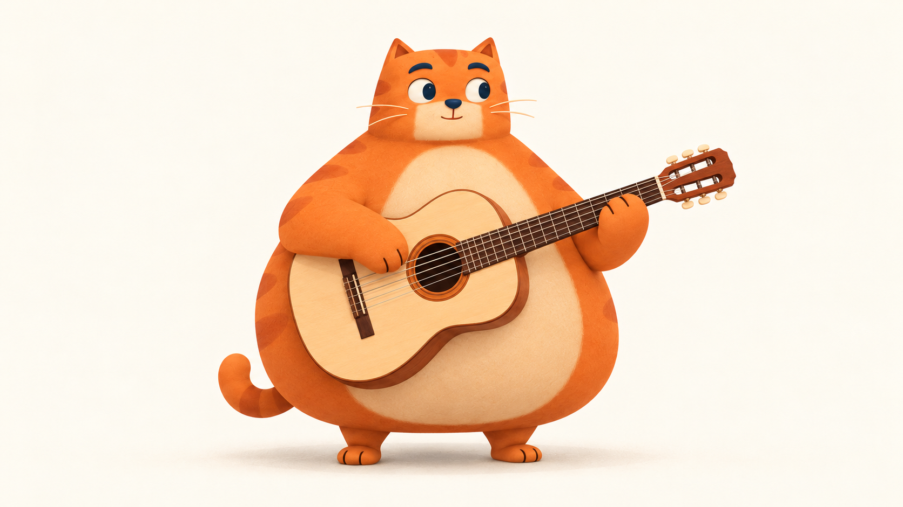

# 在另一台电脑生成 Miao 动作视频

2026-10-23。你自己使用模型 API Key 调用；这份文档包含所需输入、完整提示词、参数、检查方法和回传内容。先只生成一条吉他视频。

这次准备的是原创橘猫的三视图及完整演奏首帧。线上0.7动画仍是用户否定的版本；新图没有拆回旧骨骼，也没有当作新动画部署。动画是否自然，要等实际视频出来再判断。

## 1. 拉取资料

新电脑：

```sh
git clone https://github.com/farmcan/miao-beat.git
cd miao-beat
```

已有仓库时，切到自己的干净 main 再 `git pull --ff-only`。这一步用图片和提示词即可，不需要安装本站的 Node 依赖。

素材目录是 `design/video-motion-pilot-2026-10-23/`：

| 文件 | 用途 |
| --- | --- |
| [01-turnaround.png](../design/video-motion-pilot-2026-10-23/01-turnaround.png) | 同一角色的正面、侧面、背面；放角色参考槽，不当视频首帧 |
| [02-guitar.png](../design/video-motion-pilot-2026-10-23/02-guitar.png) | **这次要上传的单张视频首帧** |
| [03-keyboard.png](../design/video-motion-pilot-2026-10-23/03-keyboard.png) | 后续键盘构图备选，先不生成视频 |
| [04-drums.png](../design/video-motion-pilot-2026-10-23/04-drums.png) | 后续鼓组构图备选，先不生成视频 |



这些是单独生成的场景图，尚未做跨场景逐像素对齐；以后切换乐器时要再统一角色比例和地面位置。键盘黑键分组与鼓棒握持也要复查，不能因为场景图好看就直接批量接入。

## 2. 调用模型

用你熟悉的图生视频 API。服务商和模型尚未指定，所以这里描述输入含义，不杜撰某家 API 的 endpoint 或 JSON 字段。

| 输入/设置 | 本次值 |
| --- | --- |
| 输入类型 | 图生视频，单张首帧 |
| 首帧图 | 上传原始 `02-guitar.png`，不上传截图或三视图整张 |
| 可选角色参考 | 有独立角色参考槽时可附 `01-turnaround.png`；没有就只传首帧 |
| 时长 | 5秒；模型只支持10秒时用10秒，仍只做一次扫弦 |
| 画幅/输出 | 16:9，1080p；按服务实际支持的参数设置，不拉伸猫 |
| 机位 | 固定，无运镜、无切镜 |
| 声音 | 画面优先，可关闭音频；不用配乐、对白或音效 |
| 首尾帧 | 支持时可尝试同一张首帧作尾帧；不支持就只用首帧 |
| 数量 | 先1条；不要直接批量生成所有乐器和方向 |

原始吉他图是1672×941，接近16:9，并非1920×1080。保持原图比例，由视频服务适配画布；不要自行把角色横向或纵向拉伸。

Key只在你自己的调用环境使用，不写进本仓库、结果文件、截图或聊天。我接回视频不需要Key。

## 3. 直接复制下面的完整提示词

同文也保存在 [guitar-video.txt](../design/video-motion-pilot-2026-10-23/prompts/guitar-video.txt)。

```text
使用上传图片作为同一只猫、同一把吉他、同一机位的起始画面。固定摄像机，平视略带三分之四角度，全身与完整吉他始终在画面内。纯浅米色背景、光照、影子、镜头距离和角色比例保持不变。不要出现文字、字幕、粒子、音符、红点、额外物品或其他猫。

生成一段5秒的细腻角色动画，只做一次轻松、清楚的小扫弦：开头约1秒自然站稳，猫的左爪（画面右侧）一直扶稳琴颈，右爪（画面左侧）在音孔附近轻微提起，短促向下扫过琴弦，跟随一点点肩肘与胸口的自然运动，然后柔和回到原来的休息位置。中段完成动作，最后至少1秒回到与开头相近的稳定姿态。若生成10秒，延长前后停留，仍只扫一次，不加第二个动作。

动作克制、有重量、像猫投入地弹一下，而不是人类炫技。头部保持原来小方头的形状，只能很轻地跟随一下；眼睛自然地注意吉他，避免突然换一张闭眼笑脸。两只脚牢牢站在原处。短而饱满的手臂与身体连为整体，爪子保持圆润的猫爪，不长出人类手指；肩、肘、手腕自然连贯，不像铰链或橡皮软管。

琴身靠在肚子上，琴颈和琴身不移动比例；六根弦、音孔、琴桥、琴头保持稳定，不能融化或弯曲。扶琴的爪不滑动，扫弦爪与琴弦接触位置合理，不能穿过木头。保持脸、条纹、肚皮、尾巴、材质与原图一致。无相机摇晃、推拉、旋转、变焦、切镜、人物转身、跳舞、走路、挥手、连续乱扫或动态模糊遮挡。

画面优先，可无声，不生成背景音乐或对白。首尾姿态尽量相同，但不要为了循环而倒放整段动作。
```

## 4. 输出后先看这五件事

看原速，再半速看一次，最后连续重复三次：

1. 猫的脸、体形、条纹、脚底位置是否稳定，没有忽大忽小。
2. 是否真的只有一次扫弦，扶琴颈的爪一直稳住，肩肘与扫弦爪连贯。
3. 琴、弦和爪是否形状稳定，没有多爪、穿琴、融化或握持滑脱。
4. 身体是自然细小配合，没有整张图左右摇摆，或者手臂独自像管子伸缩。
5. 结尾是否能回到开头附近的稳定姿态，而不是用倒放制造循环。

明显失败也把结果保留下来，注明哪一秒有问题；不要为了凑“通过”只截好看的静帧。先不做第二种乐器。两次出现同类握持/形变问题时停下，把结果发回来，我们改关键姿态方案，不继续盲目批量生成。

## 5. 回传给我

发回 **原始MP4**，不要先剪辑、抠图、转GIF、插帧、配乐或加字幕。同时给出模型名和实际参数，以及你觉得最怪的秒数。

你可以把文件放在仓库的 `design/video-motion-pilot-2026-10-23/results/`，也可以直接在聊天上传。建议命名 `guitar-take-01.mp4`。旁边放一份 `guitar-take-01.json`：

```json
{
  "take": "guitar-take-01",
  "provider": "填写实际服务商",
  "model": "填写实际模型版本",
  "input_image": "02-guitar.png",
  "prompt_file": "prompts/guitar-video.txt",
  "duration_seconds": 5,
  "resolution": "填写实际输出尺寸",
  "fps": null,
  "seed": null,
  "first_last_frame_used": false,
  "notes": "例如：2.1秒扶琴爪滑动；整体还可以"
}
```

不清楚的值保留null。不要放API Key、Authorization、Cookie或带访问凭据的下载链接。

## 6. 我拿到视频后负责什么

先审看完整动作，标出接触与回弹帧，再做统一画布、抠背景和短动作切片。浅米色背景与奶油肚颜色接近，不会直接一键删米色；先比较实际效果。

接线先做独立吉他预览：单击能扫弦、连续按键维持演奏、停下自然收尾。声音仍按真实输入立即产生，不等五秒视频播放；快按也不会每次把整段视频归零。只有整体动作和连续输入都可看，才接回正式站。三视图、首帧和自动几何测试本身都不等于动画验收。

## 参考与源码调查

原小红书是 [陈小爷的追光猫](https://xhslink.cn/o/8oQtxWNLGCT)。本轮在原视频画面重新读到即梦Seedance 2.0 Pro、16:9、1080p、10s；借用的是“先生成完整动作，再抽帧组织交互”的方法，没有复制作者猫图或视频。

查到了真实GitHub skills：[character-animation-skill](https://github.com/karem505/character-animation-skill/tree/6fb1cdb1071c32d381ea0ee995014f9b0b6d96fd)的已有视频抽帧，以及[video2dsprite](https://github.com/0x0funky/agent-sprite-forge/tree/5324342fdfab72430f4e9604f3fe427009f8596d/skills/video2dsprite)的统一画布、锚点与短动作时序。已读源码和MIT许可，尚未安装或调用它们的付费生成接口；它们也不会自动解决猫的自然演奏。具体限制和备选见[研究记录](research/whole-character-motion-2026-10-23.md)。
