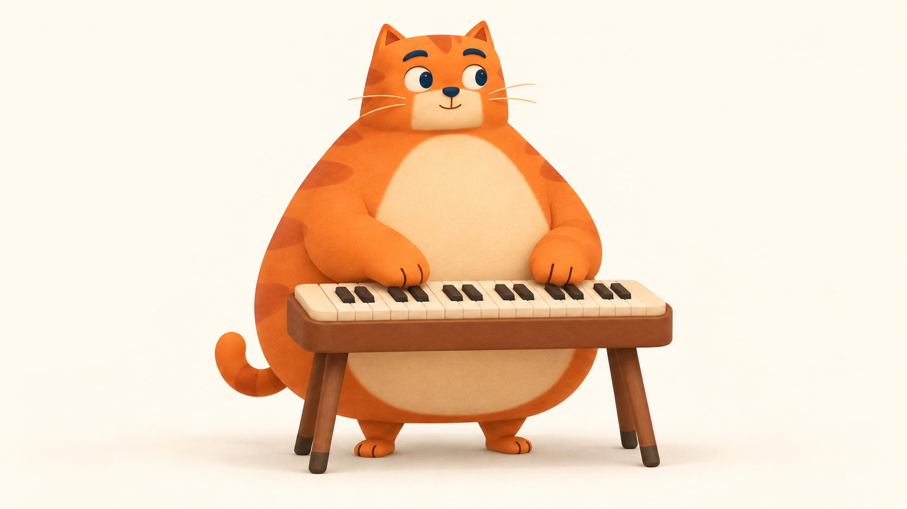

# 在另一台电脑生成 Miao 动作视频

## 当前路线 · 2026-10-25

现在沿用完整场景逐帧方案，最新实现与验收见[0.11吉他、鼓和文案](whole-band-release-2026-10-25.md)，钢琴见[0.10完整画面](whole-frame-release-2026-10-25.md)。拉取最新main即可取到原始PNG、每张提示词与来源记录：

- 钢琴：`design/whole-cat-frames-2026-10-25/frames/` 与 `prompts/`。
- 吉他、鼓：`design/instrument-whole-scenes-2026-10-25/{guitar,drums}/frames/` 与各自 `prompts/`。
- 网站采用每状态一张完整猫+双臂双爪+乐器的图；不分离肢体、不套回旧rig。离散姿态不等于新生成连续视频。
- 如继续调用视频模型，优先用最新完整idle与对应动作整图作首帧/姿态参考；单条先验证一个短动作。完整键盘视频提示词见 `design/whole-cat-frames-2026-10-25/video-prompt-whole-left-three.txt`。参数按你实际接口支持处理，不把历史示例当当前兼容保证。
- 圆爪画面仅作演奏示意，吉他精确品位与真实手机听感仍需另验。不要把本地/自动测试或图片文件数当自然度通过。

以下是2026-10-23视频交接及后续接线的历史记录，保留来源与失败边界；其中“线上0.7”“还未上线”等状态仅对应当时，当前以以上两份发布记录为准。


2026-10-23。你自己使用模型 API Key 调用；这份文档包含所需输入、完整提示词、参数、检查方法和回传内容。当前先生成一条左右爪依次按白键的键盘视频。

这次准备的是原创橘猫的三视图及完整演奏首帧。线上0.7动画仍是用户否定的版本；新图没有拆回旧骨骼，也没有当作新动画部署。已收到并检查第一条吉他视频；当前按用户纠正改为键盘试弹。增加时长是为了容纳多个清楚的按键，不把规律扫弦当作新的目标。

## 1. 拉取资料

新电脑：

```sh
git clone https://github.com/farmcan/miao-beat.git
cd miao-beat
```

已有仓库时，切到自己的干净 main 再 `git pull --ff-only`。这一步用图片和提示词即可，不需要安装本站的 Node 依赖。

素材目录是 `design/video-motion-pilot-2026-10-23/`：

| 文件 | 用途 |
| --- | --- |
| [01-turnaround.png](../design/video-motion-pilot-2026-10-23/01-turnaround.png) | 同一角色的正面、侧面、背面；放角色参考槽，不当视频首帧 |
| [02-guitar.png](../design/video-motion-pilot-2026-10-23/02-guitar.png) | 第一轮吉他参考，暂不继续生成扫弦 |
| [03-keyboard.png](../design/video-motion-pilot-2026-10-23/03-keyboard.png) | **当前要上传的单张首帧：两爪在小键盘前** |
| [04-drums.png](../design/video-motion-pilot-2026-10-23/04-drums.png) | 后续鼓组构图备选，先不生成视频 |



这些是单独生成的场景图，尚未做跨场景逐像素对齐；以后切换乐器时要再统一角色比例和地面位置。键盘黑键分组与鼓棒握持也要复查，不能因为场景图好看就直接批量接入。

## 2. 调用模型

用你熟悉的图生视频 API，保留你已跑通的模型与图片传入方式。具体模型版本和创建任务请求尚未提供，不根据临时结果链接猜测。

| 输入/设置 | 本次值 |
| --- | --- |
| 输入类型 | 图生视频，单张首帧 |
| 首帧图 | 上传原始 `03-keyboard.png`，不上传截图或三视图整张 |
| 可选角色参考 | 有独立角色参考槽时可附 `01-turnaround.png`；没有就只传首帧 |
| 时长 | 用API参数明确设为10秒；只在提示词写10秒不代表请求已采用 |
| 画幅/输出 | 16:9；先用模型支持的720p检查动作，支持时可选1080p；不拉伸猫 |
| 机位 | 固定，无运镜、无切镜 |
| 声音 | 画面优先，可关闭音频；不用配乐、对白或音效 |
| 首尾帧 | 支持时可尝试同一张首帧作尾帧；不支持就只用首帧 |
| 数量 | 先1条；不要直接批量生成所有乐器和方向 |

原始键盘图是1672×940，接近16:9，并非1920×1080。保持原图比例，由视频服务适配画布；不要自行把角色横向或纵向拉伸。

如果直接使用方舟原生接口，可以在你已有的创建请求中明确增补下面三个顶层字段；这是参数片段，不是完整请求，不替换原有model与content：

```json
{
  "duration": 10,
  "ratio": "16:9",
  "resolution": "720p"
}
```

火山官方的[Seedance 2.0说明](https://docs.volcengine.com/docs/ark/seedance-2-0?lang=en)列出了这些时长、画幅与分辨率字段。第三方封装按其实际字段映射；具体模型支持的分辨率也需对应确认。返回后检查实际视频时长/尺寸，不仅看prompt或提交成功。

Key只在你自己的调用环境使用，不写进本仓库、结果文件、截图或聊天。我接回视频不需要Key。

## 3. 直接复制下面的完整提示词

当前版本：[keyboard-press-sequence-v2.txt](../design/video-motion-pilot-2026-10-23/prompts/keyboard-press-sequence-v2.txt)。左右一律按画面位置描述；目标是六次能看清接触和回弹的按键，不是泛泛写“猫弹钢琴”。

```text
沿用上传首帧中同一只橘猫、同一架小键盘、同一浅米色背景和柔和光照，固定机位，完整看见猫、两只爪子和整个键盘。这里的“左爪、右爪”均指画面左侧和画面右侧，不按猫自身的左右命名。

做一段约10秒的自然试弹小旋律。主要时间用于真实可辨认的按键动作，开头和结尾各停留约半秒。两只圆猫爪放松地悬在白键上方，左右交替挨个按键，手臂活动范围保持在各自面前，不交叉。

动作顺序：画面左爪先按左中区域的一个白键，抬起；右爪再按右中区域的一个白键，抬起。左爪向自己刚才按的白键右侧移一个键宽，按相邻白键并抬起；右爪也移向自己刚才按键右侧的相邻白键，按下并抬起。再按这个方式交替一次，形成约六次清楚分开的按键，像慢慢弹出一小串旋律。没有动作的一只爪自然等在自己区域的键上方。

每次按键都明确表现完整动作：爪子先移动到白键正上方，短距离垂直下压，爪垫碰到键面，那个白键的前端随压力轻微下降；随后爪子抬起，白键回弹到原位，再去下一个键。按键有轻重和柔软回弹，不能只是在琴面上空摆爪或沿键盘拖着滑动。琴键保持硬质直条形状，只在后端支点处轻微转动，不融化或弯成软条；键盘和支架整体不晃动。

短而饱满的手臂、肩、肘与身体自然连贯，肩肘随下压有克制的小幅配合，目光轻轻注意正在弹的键；头部与上身只有细微反应，双脚始终站稳。圆润猫爪不长出人类手指，不追求逐指钢琴技巧，不伸长手臂够远处的键。猫的脸、体形、条纹、材质、影子和比例保持一致。结尾双爪轻松抬回白键上方，保持仍可继续弹的准备姿势。

没有运镜、切镜、推拉、转身、跳舞、字幕、音符特效或新增物品。画面可无声；不要用整张图片左右摇晃代替演奏，也不要用倒放制造回弹。
```

第一轮[单次扫弦prompt](../design/video-motion-pilot-2026-10-23/prompts/guitar-video.txt)保留作历史，这次不用它，也不用延长扫弦视频。

## 4. 输出后先看这五件事

看原速，再半速看一次，最后连续重复三次：

1. 猫的脸、体形、条纹、脚底位置是否稳定，没有忽大忽小。
2. 是否左右交替，并换到各自相邻的白键；另一只爪不跟着乱动、手臂不交叉。
3. 每一下是否看见爪下压、对应白键下降、爪抬起、琴键回弹；不是悬空比划或擦过琴面。
4. 身体是自然细小配合，没有整张图左右摇摆，或者手臂独自像管子伸缩。
5. 结尾是否能回到开头附近的稳定姿态，而不是用倒放制造循环。

明显失败也把结果保留下来，注明哪一秒有问题；不要为了凑“通过”只截好看的静帧。先不做第二种乐器。两次出现同类接触/形变问题时停下，把结果发回来，我们改关键姿态方案，不继续盲目批量生成。

## 5. 回传给我

发回 **原始MP4**，不要先剪辑、抠图、转GIF、插帧、配乐或加字幕。同时给出模型名和实际参数，以及你觉得最怪的秒数。

你可以把文件放在仓库的 `design/video-motion-pilot-2026-10-23/results/`，也可以直接在聊天上传。建议命名 `keyboard-take-01.mp4`。旁边放一份 `keyboard-take-01.json`：

```json
{
  "take": "keyboard-take-01",
  "provider": "填写实际服务商",
  "model": "填写实际模型版本",
  "input_image": "03-keyboard.png",
  "prompt_file": "prompts/keyboard-press-sequence-v2.txt",
  "duration_seconds": 10,
  "resolution": "填写实际输出尺寸",
  "fps": null,
  "seed": null,
  "first_last_frame_used": false,
  "notes": "例如：第二次按键没有让琴键下沉；左爪换键清楚"
}
```

不清楚的值保留null。不要放API Key、Authorization、Cookie或带访问凭据的下载链接。

## 原始视频先归档，再评审

2026-10-25早期纠正（保留历史）：前两条视频只做了流式查看和评审记录，没有保存原始MP4。键盘视频的临时链接随后过期，当前缺少可切片、可发布的真实源文件。评审JSON、截图和浏览器播放成功均不能代替素材归档；新的动画尚未上线。

以后先把完整MP4保存在本地，再检查SHA、时长、尺寸，随后才预览和切片。仓库新增了归档命令：

```sh
python3 scripts/archive-motion-video.py --name keyboard-take-01 --file /path/to/your/video.mp4
```

它把原片和校验元数据保存在Git忽略的 `assets-source/motion/keyboard-take-01/`，不覆盖已有take。临时下载链接可以通过 `--url-stdin` 从标准输入传入，脚本不保存或打印该链接。原片是本地归档，不会因Git push自动出现在另一台电脑；跨电脑仍应传原始文件或提供当时有效的下载链接。发布只带经检查的衍生动画和公开来源说明。

## 6. 我拿到视频后负责什么

先审看完整动作，标出接触与回弹帧，再做统一画布、抠背景和短动作切片。浅米色背景与奶油肚颜色接近，不会直接一键删米色；先比较实际效果。

接线先做独立键盘动作预览：按下能看见对应一侧的按键动作，左右输入可区分，松开回弹。声音仍按真实输入立即产生，不等待十秒素材播完；快按也不会每次把整段视频归零。预生成六次按键只是美术素材，网页上的真实按键顺序由用户决定，不按视频固定顺序自动弹奏。只有整体动作和连续输入都可看，才接回正式站。三视图、首帧和自动几何测试本身都不等于动画验收。

## 已收到的第一条视频

首条吉他样片的浏览器元数据为4.041667秒、1280×720。本轮通过远程流式播放器检查0、0.75、1、1.25、1.5、1.75、2.25、3、4秒的画面：提爪、下扫和回姿可以辨认，检查帧中的猫/琴整体形状较旧拼肢体版本稳定，后段主要停留。没有据此宣称逐帧无缺陷、首尾像素相同、音频已试听或网页连按已验收。

上一份prompt明确要求只扫一次、前后停留，因此素材不包含完整连续的键盘演奏。实际创建请求未提供，4秒/720p的成因不能仅凭prompt确定。用户现明确优先键盘图，目标为挨个按键、左右爪都可用；下一条按上文生成，不继续规律扫弦。临时签名视频地址不存入仓库。

## 参考与源码调查

原小红书是 [陈小爷的追光猫](https://xhslink.cn/o/8oQtxWNLGCT)。本轮在原视频画面重新读到即梦Seedance 2.0 Pro、16:9、1080p、10s；借用的是“先生成完整动作，再抽帧组织交互”的方法，没有复制作者猫图或视频。

查到了真实GitHub skills：[character-animation-skill](https://github.com/karem505/character-animation-skill/tree/6fb1cdb1071c32d381ea0ee995014f9b0b6d96fd)的已有视频抽帧，以及[video2dsprite](https://github.com/0x0funky/agent-sprite-forge/tree/5324342fdfab72430f4e9604f3fe427009f8596d/skills/video2dsprite)的统一画布、锚点与短动作时序。已读源码和MIT许可，尚未安装或调用它们的付费生成接口；它们也不会自动解决猫的自然演奏。具体限制和备选见[研究记录](research/whole-character-motion-2026-10-23.md)。

## 2026-10-25 新 take 已归档并接线

新收到的另一条键盘视频已成功下载：2,775,311 字节、1280×720、24fps、10.041667 秒、无音轨。SHA-256：`17a223bc41021898f120d2660b4c0787660a07ff157d1910d8f2f6f2572bd8a5`。这是新的素材对象，不是旧过期对象找回。

原片与探测信息在 Git 忽略的 `assets-source/motion/keyboard-take-20261025/`；可跨电脑获取的无音轨、去元数据 MP4 已提交为 `public/character/keyboard-demo-v1.mp4`。画面与原片的视频流相同，容器重新打包，因此文件 SHA 不同。无需重新调用模型即可继续使用这一版。公开预览为 `/labs/keyboard-motion/`。

运行 `python3 scripts/prepare-keyboard-motion.py` 可从校验后的本地原片复现图集/动作映射。没有原片的另一台电脑可直接使用已提交衍生素材，无需重新生成。脚本依赖 ffmpeg/ffprobe；原始签名地址不落盘、不入 Git。

本次直接保留完整猫与琴，统一裁切缩放，抽取13个姿态。四个音区和双手状态可读；不声称每个音都准确压到十三个独立物理键，也不把别的乐器旧动作算成本轮升级。后续素材如需提高准确度，应在同一机位/身体姿态下分别给出各音区的提爪、接触、松开，避免另一只爪和躯干同时改变。详细验收及已知限制见[本轮发布记录](whole-character-release-2026-10-25.md)。
